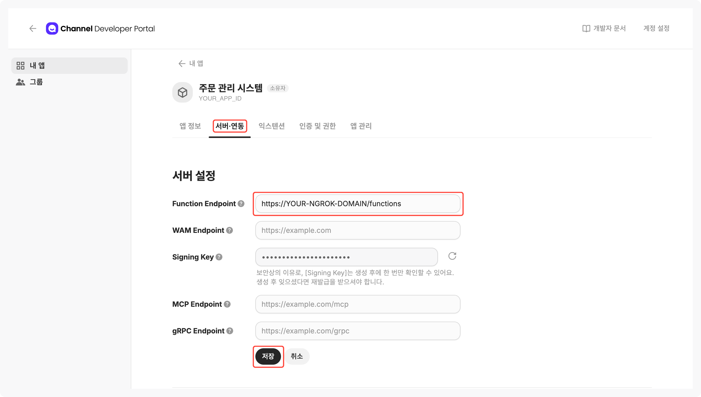
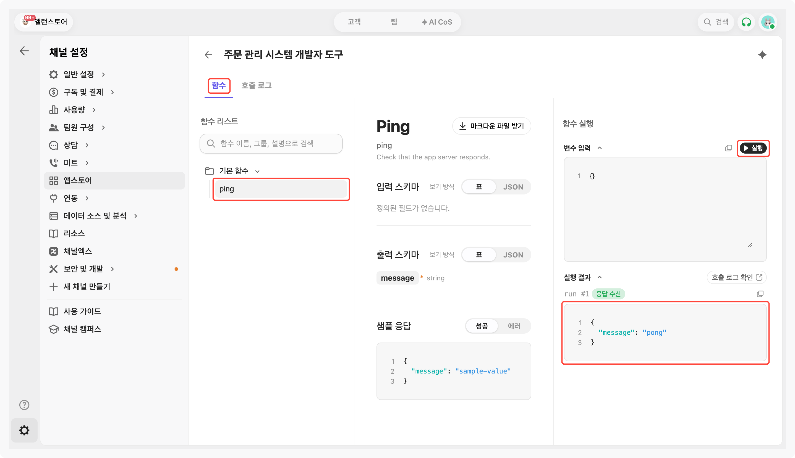
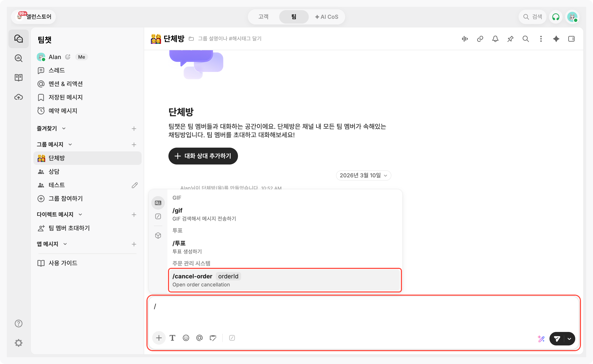

# 간단하게 앱 서버 만들어보기

Channel App SDK로 가상의 주문 관리 시스템을 만들고 채널톡과 연동해봅니다. 주문 조회와 취소를 앱 함수로 구현하고, 개발자 도구에서 주문을 조회해봅니다. 이어서 Command Extension으로 등록한 `/cancel-order`로 WAM을 열어 주문을 취소해봅니다. 매니저가 주문을 취소하면 앱 서버가 Native Function을 호출해 취소 결과를 알려줍니다.

## 사전 준비

- **Node.js 24 LTS** 최신 버전을 설치하세요. [Node.js 다운로드](https://nodejs.org/en/download)
- **pnpm 10.26 이상**을 설치하세요. 서버와 WAM의 패키지를 관리하고 각 프로젝트를 빌드할 때 사용합니다. [pnpm 설치](https://pnpm.io/installation)
- **코드 편집기와 터미널**을 준비하세요. 터미널 하나에서 서버를 실행하고, 다른 터미널에서 실습 명령을 입력합니다.
- **ngrok CLI와 계정**을 준비하세요. 앱스토어가 로컬 서버에 요청을 보낼 수 있도록 HTTPS 주소를 만들 때 사용합니다. [ngrok 설치와 설정](https://ngrok.com/docs/start)

## 1. 첫 앱 만들기

개발자 포털에서 앱을 만들고 발급받은 키를 저장한 뒤, [Channel App SDK](https://github.com/channel-io/app-sdk)로 `ping` 함수를 구현해 [NestJS](https://nestjs.com/) 기반 서버를 띄워봅니다. 개발자 도구에서 이 함수를 호출해 연결을 확인해봅니다.

### Channel Developer Portal에서 앱 생성하기

[Channel Developer Portal](https://channel.works/-/developers/apps)의 **내 앱**에서 **앱 만들기**를 누르세요. 앱 이름에 **주문 관리 시스템**을 입력하세요. 약관에 동의한 뒤 **확인**을 누르세요.


### 앱 ID와 키 저장하기

앱을 만든 뒤 터미널에서 아래 명령을 실행해 실습 폴더와 `.env` 파일을 만드세요.

```sh
mkdir order-management
cd order-management
mkdir -p server/src
touch server/.env
```

이제 `server/.env`를 열고 아래 세 항목을 추가하세요. Git을 사용한다면 키를 넣기 전에 `.env`를 `.gitignore`에 추가하세요. Secret과 Signing Key는 발급 직후에 한 번만 볼 수 있습니다. 화면을 닫기 전에 각 값을 `server/.env`에 바로 저장하세요.

```dotenv
APP_ID=
APP_SECRET=
SIGNING_KEY=
```


앱 상세 화면에서 앱 이름 아래에 있는 **Application ID**를 `APP_ID`에 넣으세요. 이 값으로 앱스토어가 앱을 구분합니다.

**인증 및 권한**에서 **Secret**의 **발급하기**를 누르고 발급받은 값을 `APP_SECRET`에 넣으세요. SDK는 이 값으로 앱스토어에서 앱 토큰을 받습니다.


**서버 설정**에서 **Signing Key**의 **발급하기**를 누르고 발급받은 값을 `SIGNING_KEY`에 넣으세요. 서버는 이 값으로 앱스토어가 보낸 요청의 서명을 검증합니다.

> **Signing Key가 필요한 이유**
>
> 서명을 검증하지 않으면 제3자가 앱스토어를 사칭해 앱 함수를 호출할 수 있습니다. 앱스토어는 Signing Key와 요청 본문으로 HMAC-SHA256 서명을 계산하고, Base64로 인코딩한 값을 `x-signature` 헤더에 담아 보냅니다. 앱 서버는 같은 키와 수신한 본문의 원본 바이트로 서명을 다시 계산합니다. **서명이 헤더 값과 일치하는 요청만 함수 처리 단계로 넘겨야 합니다.** Channel App SDK는 이 검증을 `SignatureGuard`로 제공합니다.

### 프로젝트 준비하기

프로젝트 루트에 `pnpm-workspace.yaml`을 만들고 아래와 같이 `server`를 등록하세요.

```yaml
packages:
  - server

allowBuilds:
  protobufjs: false
```

`allowBuilds`는 pnpm이 설치 중 실행할 의존성 스크립트를 정합니다. 서버 SDK가 사용하는 `protobufjs`에 `false`를 지정해 설치 스크립트를 건너뜁니다.

`server/package.json`을 만들고 아래와 같이 작성하세요. 서버가 사용할 빌드와 실행 명령을 정의합니다.

```json
{
  "name": "order-server",
  "private": true,
  "type": "module",
  "scripts": {
    "build": "tsc",
    "start": "node --env-file=.env dist/index.js"
  }
}
```

프로젝트 루트에서 아래 명령을 실행해 서버 패키지에 의존성을 설치하세요. `@channel.io/app-sdk-server`는 NestJS 기반 패키지입니다. 이 실습에서는 HTTP 어댑터로 `@nestjs/platform-express`를 사용합니다.

```sh
pnpm --dir server add @channel.io/app-sdk-server @nestjs/common@11 @nestjs/core@11 @nestjs/platform-express@11 reflect-metadata zod@3
pnpm --dir server add -D typescript@5 @types/node@24
```

`server/tsconfig.json`을 만들고 아래와 같이 작성하세요. 서버 코드는 `server/src`에 작성하세요. TypeScript는 컴파일한 JavaScript를 `server/dist`에 저장합니다.

```json
{
  "compilerOptions": {
    "target": "ES2022",
    "module": "NodeNext",
    "rootDir": "src",
    "outDir": "dist",
    "strict": true,
    "experimentalDecorators": true,
    "emitDecoratorMetadata": true,
    "skipLibCheck": true
  },
  "include": ["src"]
}
```

### `ping` 함수 만들기

`server/src/ping.function.ts`를 만들고 아래와 같이 작성하세요. `ping`은 입력값 없이 호출할 수 있고, `message`에 `pong`을 담아 반환합니다. `@Func`는 함수 이름을 선언하고, `@InputSchema`와 `@OutputSchema`는 입출력 형식을 정의합니다.

```ts
import { Injectable } from "@nestjs/common";
import {
  type Context,
  Ctx,
  Func,
  Input,
  InputSchema,
  OutputSchema,
} from "@channel.io/app-sdk-server";
import { z } from "zod";

const PingInputSchema = z.object({});
type PingInput = z.infer<typeof PingInputSchema>;
const PingOutputSchema = z.object({ message: z.literal("pong") });

@Injectable()
export class PingFunctions {
  @Func({ name: "ping", description: "Check that the app server responds." })
  @InputSchema(PingInputSchema)
  @OutputSchema(PingOutputSchema)
  ping(@Ctx() ctx: Context, @Input() input: PingInput) {
    console.log("ping function call", { ctx, input });
    return { message: "pong" };
  }
}
```

`server/src/index.ts`를 만들고 아래와 같이 작성하세요. 이 파일에서 SDK 모듈을 설정하고 `PingFunctions`를 `providers`에 등록합니다. Express 어댑터의 메서드를 사용할 수 있도록 앱 타입을 `NestExpressApplication`으로 지정합니다.

```ts
import "reflect-metadata";
import { Module } from "@nestjs/common";
import { NestFactory } from "@nestjs/core";
import type { NestExpressApplication } from "@nestjs/platform-express";
import {
  CHANNEL_APP_OPTIONS,
  ChannelAppModule,
  SignatureGuard,
} from "@channel.io/app-sdk-server";
import { PingFunctions } from "./ping.function.js";

@Module({
  imports: [
    ChannelAppModule.forRoot({
      appId: process.env["APP_ID"] ?? "",
      appSecret: process.env["APP_SECRET"] ?? "",
      signingKey: process.env["SIGNING_KEY"] ?? "",
      autoRegister: true,
    }),
  ],
  providers: [PingFunctions],
})
class AppModule {}

const app = await NestFactory.create<NestExpressApplication>(AppModule, {
  rawBody: true,
});
app.useGlobalGuards(new SignatureGuard(app.get(CHANNEL_APP_OPTIONS)));
await app.listen(3000);
```

앱스토어는 서버의 `PUT /functions/v1`으로 요청을 보냅니다. NestJS의 `rawBody: true`는 요청 본문의 원본을 보관합니다. SDK의 `SignatureGuard`는 그 원본과 Signing Key로 `x-signature` 헤더의 서명을 검증합니다.

### ngrok으로 서버 열기

앱스토어가 로컬 서버를 호출할 수 있도록 ngrok으로 HTTPS 주소를 만드세요. 인증 토큰을 아직 등록하지 않았다면 첫 번째 명령을 실행하세요. 다른 터미널에서 `ngrok http 3000`을 실행하고 켜 두세요.

```sh
ngrok config add-authtoken YOUR_NGROK_AUTHTOKEN
ngrok http 3000
```

### Function Endpoint 설정하기

`Forwarding`에 나온 HTTPS 주소 뒤에 `/functions`를 붙이세요. 예를 들어 `https://YOUR-NGROK-DOMAIN/functions`입니다. 개발자 포털의 **서버 설정**에서 이 주소를 **Function Endpoint**에 입력하고 **저장**을 누르세요. 앱스토어가 버전을 지정해 함수를 호출하면 `/v1`을 붙여 요청합니다.



### 앱 서버 등록하기

프로젝트 루트에서 아래 명령으로 서버를 빌드하고 실행하세요. `pnpm --dir server start`는 `server/.env`를 읽습니다. 앞에서 `autoRegister: true`로 설정했기 때문에 서버를 시작하면 SDK가 App Secret으로 앱 토큰을 받아 `core:v1`을 등록합니다. 앱스토어는 Function Endpoint에 서명된 요청을 보내 `ping`을 함수 목록에 올립니다.

```sh
pnpm --dir server build
pnpm --dir server start
```

서버 로그에 `Successfully registered extension: core`가 표시되면 `core:v1` 등록에 성공한 거예요. 이제 개발자 도구에서 `@Func`로 선언한 `ping`을 호출해봅니다.

### 개발자 도구에서 실제 요청 확인하기

테스트 채널 왼쪽 아래의 설정 아이콘으로 채널 설정을 여세요. **앱스토어**에서 **주문 관리 시스템**을 검색하고 **설치**를 누르세요. 설치한 뒤 앱 상세에서 **개발자 도구**를 선택하세요.


**함수** 탭에서 `ping`을 선택한 뒤 **실행**을 누르세요. **실행 결과**에 `{"message":"pong"}`이 표시됩니다.



함수를 호출한 뒤 서버 터미널에서 `ctx`가 어떤 형태로 들어오는지 확인해보세요. 다음은 호출자 정보인 `caller`와 채널 정보인 `channel`이 포함된 출력 예시입니다.

```text
ping function call {
  ctx: {
    caller: { type: 'manager', id: 'example-manager-id' },
    channel: { id: 'example-channel-id' }
  },
  input: {}
}
```

## 2. 주문 조회 함수 추가하기

같은 앱에 샘플 주문을 저장하는 서비스와 주문 조회 함수를 추가해봅니다.

`server/src/orders.service.ts`를 만들고 아래 코드를 넣으세요. `OrderService`는 샘플 주문을 메모리에 채널별로 저장합니다. `order-1`은 이미 발송한 주문(`shipped`)입니다. `order-2`와 `order-3`은 나중에 취소해 볼 수 있도록 대기 상태(`pending`)로 둡니다. 서버를 다시 띄우면 주문 상태가 처음으로 돌아갑니다.

```ts
import { Injectable } from "@nestjs/common";

type OrderStatus = "pending" | "shipped" | "cancelled";

export class NotFoundError extends Error {}

@Injectable()
export class OrderService {
  private readonly ordersByChannel = new Map<string, Map<string, OrderStatus>>();

  getStatus(channelId: string, orderId: string) {
    const status = this.ordersFor(channelId).get(orderId);
    if (!status) {
      throw new NotFoundError("Order not found");
    }
    return { orderId, status };
  }

  private ordersFor(channelId: string) {
    let orders = this.ordersByChannel.get(channelId);
    if (!orders) {
      orders = new Map<string, OrderStatus>([
        ["order-1", "shipped"],
        ["order-2", "pending"],
        ["order-3", "pending"],
      ]);
      this.ordersByChannel.set(channelId, orders);
    }
    return orders;
  }
}
```

> **채널 단위 인가**
>
> 앱은 여러 채널에 설치할 수 있습니다. 이 예제에서는 요청 컨텍스트의 `ctx.channel.id`로 채널별 주문을 구분합니다. 실제 주문을 조회하거나 취소할 때는 호출자가 해당 채널에서 그 작업을 할 권한이 있는지도 확인하세요.

`server/src/orders.function.ts`를 만들고 아래와 같이 작성하세요. `OrderFunctions`는 요청에 담긴 채널 ID로 `OrderService`에서 주문을 조회합니다. 주문을 찾지 못하면 `OrderService`가 `NotFoundError`를 던지고, `OrderFunctions`가 이 오류를 SDK의 `FunctionCallError`로 바꿉니다.

```ts
import { Injectable } from "@nestjs/common";
import {
  type Context,
  Ctx,
  Func,
  FunctionCallError,
  FunctionCallErrorCode,
  Input,
  InputSchema,
  OutputSchema,
} from "@channel.io/app-sdk-server";
import { z } from "zod";
import { NotFoundError, OrderService } from "./orders.service.js";

const GetStatusInputSchema = z.object({ orderId: z.string() });
type GetStatusInput = z.infer<typeof GetStatusInputSchema>;
const GetStatusOutputSchema = z.object({ orderId: z.string(), status: z.string() });

@Injectable()
export class OrderFunctions {
  constructor(private readonly orderService: OrderService) {}

  @Func({
    name: "orders.getStatus",
    description: "Look up the shipping status of an order by its ID.",
  })
  @InputSchema(GetStatusInputSchema)
  @OutputSchema(GetStatusOutputSchema)
  getStatus(@Ctx() ctx: Context, @Input() input: GetStatusInput) {
    console.log("orders.getStatus function call", { ctx, input });
    try {
      return this.orderService.getStatus(ctx.channel.id, input.orderId);
    } catch (error) {
      if (error instanceof NotFoundError) {
        throw new FunctionCallError(error.message, FunctionCallErrorCode.NotFound);
      }
      throw error;
    }
  }
}
```

`server/src/index.ts`에 아래 import를 추가하고, `@Module`의 `providers`에 `OrderService`와 `OrderFunctions`를 추가하세요.

```ts
// server/src/index.ts (add imports)
import { OrderFunctions } from "./orders.function.js";
import { OrderService } from "./orders.service.js";
```

```ts
// server/src/index.ts (AppModule providers)
providers: [PingFunctions, OrderService, OrderFunctions],
```

서버를 `Ctrl+C`로 종료하고 아래 명령으로 다시 빌드해 띄우세요.

```sh
pnpm --dir server build
pnpm --dir server start
```

앱스토어가 함수 목록을 다시 읽으면 개발자 도구의 **함수** 탭에서 `getStatus`를 선택하세요. 함수 상세에 전체 이름인 `orders.getStatus`가 표시됩니다. `orderId`에 `order-1`을 입력하고 **실행**을 누르세요. 응답의 `status`가 `shipped`인지, 서버 터미널에 아래처럼 찍히는지 확인하세요.


```text
orders.getStatus function call {
  ctx: {
    caller: { type: 'manager', id: 'example-manager-id' },
    channel: { id: 'example-channel-id' }
  },
  input: { orderId: 'order-1' }
}
```

함수가 목록에 없다면 서버를 켠 상태에서 `core:v1` 등록 결과와 Function Endpoint를 확인하세요. **실행** 버튼이 비활성화돼 있다면 현재 채널에 앱을 설치했는지, 함수의 필수 입력값을 채웠는지 확인하세요.

## 3. Command Extension을 등록하고 WAM 열기



커맨드는 채팅 중에 앱 기능을 실행하는 명령어입니다. 위 화면처럼 팀챗의 메시지 입력창에 `/`를 입력하면 커맨드 목록이 열립니다.

Command Extension에 커맨드 이름과 실행할 앱 함수를 지정하면 앱에 커맨드를 추가할 수 있습니다. 이번에는 `command:v1`을 등록해 `/cancel-order`로 주문 취소 화면을 열어봅니다.

앱스토어는 `metadata.getCommands`로 `/cancel-order`의 설정을 읽습니다. 사용자가 커맨드를 실행하면 `actionFunctionName`에 적힌 `commands.orders.cancel`을 호출합니다. `systemVersion: "v1"`을 지정하면 SDK가 `PUT /functions/v1`으로 이 요청을 받습니다. 함수가 WAM 이름을 돌려주면 채널톡은 앱의 WAM Endpoint에서 화면을 불러옵니다.

### 앱 서버에 Command 추가하기

`server/src/command.extension.ts`를 만들고 아래와 같이 작성하세요. `CommandExtension`은 명령을 정의하고, `CommandActions`의 `commands.orders.cancel`은 WAM을 엽니다.

```ts
import { Injectable } from "@nestjs/common";
import {
  type Context,
  CommandResultSchema,
  Ctx,
  Extension,
  Func,
  type GetCommandsInput,
  GetCommandsOutputSchema,
  Input,
  InputSchema,
  OutputSchema,
} from "@channel.io/app-sdk-server";
import { z } from "zod";

@Extension({ name: "command", systemVersion: "v1" })
export class CommandExtension {
  @Func("metadata.getCommands")
  @OutputSchema(GetCommandsOutputSchema)
  getCommands(@Ctx() ctx: Context, @Input() input: GetCommandsInput) {
    console.log("extension.command.metadata.getCommands function call", { ctx, input });
    return {
      commands: [
        {
          name: "cancel-order",
          scope: "desk",
          description: "Open order cancellation",
          actionFunctionName: "commands.orders.cancel",
          systemVersion: "v1",
          alfMode: "disable",
          enabledByDefault: true,
          paramDefinitions: [{ name: "orderId", type: "string", required: true }],
        },
      ],
    };
  }
}

const ExecuteCancelOrderInputSchema = z.object({
  input: z.object({ orderId: z.string() }),
});
type ExecuteCancelOrderInput = z.infer<typeof ExecuteCancelOrderInputSchema>;

@Injectable()
export class CommandActions {
  @Func("commands.orders.cancel")
  @InputSchema(ExecuteCancelOrderInputSchema)
  @OutputSchema(CommandResultSchema)
  executeCancelOrder(@Ctx() ctx: Context, @Input() input: ExecuteCancelOrderInput) {
    console.log("commands.orders.cancel function call", { ctx, input });
    const { orderId } = input.input;
    return {
      type: "wam",
      attributes: {
        appId: process.env["APP_ID"] ?? "",
        name: "order-cancel",
        wamArgs: { orderId },
      },
    };
  }
}
```

위 예제에서 `commands.orders.cancel`이 반환한 `name`은 WAM Endpoint 뒤에 붙는 경로입니다. 뒤에서 WAM을 React로 구현할 때는 `useWamData("orderId")`로 `wamArgs`에 담긴 주문번호를 읽어 화면에 표시해봅니다.

나중에 다른 WAM을 구현할 때는 액션의 `name`에 새 WAM 이름을 넣으세요. WAM마다 `wam/<name>`에 소스를 두고, 빌드한 정적 파일을 `/wam/<name>/`에서 제공하면 됩니다.

`server/src/index.ts`에 아래 import를 추가하고, `@Module`의 `providers`에 `CommandExtension`과 `CommandActions`를 추가하세요.

```ts
// server/src/index.ts (add imports)
import { CommandExtension, CommandActions } from "./command.extension.js";
```

```ts
// server/src/index.ts (AppModule providers)
providers: [
  PingFunctions,
  OrderService,
  OrderFunctions,
  CommandExtension,
  CommandActions,
],
```

### WAM을 빌드하고 서버에서 제공하기

프로젝트 루트의 `pnpm-workspace.yaml` 내용을 아래와 같이 교체하세요. `wam/*`을 추가하면 `wam/` 아래의 각 화면을 별도 패키지로 관리할 수 있습니다.

```yaml
packages:
  - server
  - "wam/*"

allowBuilds:
  esbuild: true
  protobufjs: false
```

`esbuild: true`는 Vite가 사용하는 `esbuild`의 설치 스크립트를 허용합니다.

프로젝트 루트에서 아래 명령을 실행해 `wam/order-cancel`에 Vite의 React와 TypeScript 기본 템플릿을 만들고 WAM SDK를 설치하세요. 템플릿이 만든 `package.json`, TypeScript, ESLint 설정을 그대로 사용합니다.

```sh
pnpm create vite@7 wam/order-cancel --template react-ts --no-interactive
pnpm --dir wam/order-cancel add @channel.io/app-sdk-wam
```

`wam/order-cancel/vite.config.ts`를 아래와 같이 수정하세요. `base: "./"`를 설정하면 빌드한 HTML이 `/wam/order-cancel/` 아래에서 JavaScript 같은 정적 파일을 상대 경로로 불러옵니다.

```ts
// wam/order-cancel/vite.config.ts
import { defineConfig } from "vite";
import react from "@vitejs/plugin-react";

export default defineConfig({
  plugins: [react()],
  base: "./",
  build: {
    outDir: "../../server/dist/static/order-cancel",
    emptyOutDir: true,
  },
});
```

`wam/order-cancel/src/main.tsx`와 `wam/order-cancel/src/App.tsx`의 내용을 각각 아래 코드로 교체하세요.

```tsx
// wam/order-cancel/src/main.tsx
import { createRoot } from "react-dom/client";
import { WamProvider } from "@channel.io/app-sdk-wam";
import App from "./App.tsx";

createRoot(document.getElementById("root")!).render(
  <WamProvider>
    <App />
  </WamProvider>,
);
```

```tsx
// wam/order-cancel/src/App.tsx
import { useEffect } from "react";
import { useWamData, useWamSize } from "@channel.io/app-sdk-wam";

export default function App() {
  const orderId = useWamData("orderId");
  const { setSize } = useWamSize();
  useEffect(() => setSize({ width: 400, height: 200 }), [setSize]);

  return <h1>{typeof orderId === "string" ? `Order ${orderId}` : "Order cancellation"}</h1>;
}
```

`server/src/index.ts` 상단에 아래 import를 추가하세요.

```ts
// server/src/index.ts (add import)
import { resolve } from "node:path";
```

같은 파일에서 `await app.listen(3000)` 바로 앞에 아래 코드를 추가하세요. 서버는 빌드된 `index.js`와 같은 위치의 `static/` 디렉터리를 `/wam` 경로로 제공합니다.

```ts
// server/src/index.ts (before app.listen(...))
app.useStaticAssets(resolve(import.meta.dirname, "static"), {
  prefix: "/wam",
});
```

ngrok의 `Forwarding`에 나온 HTTPS 주소 뒤에 `/wam`을 붙이세요. 개발자 포털에서 **주문 관리 시스템**의 **서버 설정**을 열고, **WAM Endpoint**에 이 주소를 입력한 뒤 **저장**을 누르세요. 예를 들어 `https://YOUR-NGROK-DOMAIN/wam`입니다.


앱스토어는 이 주소에 `name` 값인 `order-cancel`을 붙여 앱 서버에 `GET /wam/order-cancel/` 요청을 보냅니다.

서버를 종료하고, 프로젝트 루트에서 서버와 WAM을 각각 빌드한 뒤 서버를 다시 실행하세요.

```sh
pnpm --dir server build
pnpm --dir wam/order-cancel build
pnpm --dir server start
```

WAM 빌드 결과물은 `server/dist/static/order-cancel/`에 저장됩니다.

서버 로그에서 `command` 등록 성공을 확인하세요. 채널 설정의 **앱스토어**에서 **주문 관리 시스템**을 열고 **커맨드** 탭을 선택하세요. **데스크 커맨드**에 `/cancel-order`가 표시되면 스위치를 확인하고, 꺼져 있으면 켜세요.


테스트 채널의 팀챗 입력창에서 `/`를 입력하고 `/cancel-order`를 선택하세요. 주문번호에 `order-2`를 입력해 실행한 뒤 WAM에 **Order order-2**가 표시되는지 확인하세요.


명령이 보이지 않으면 서버의 `command` 등록 로그와 채널의 앱 설치 상태를 확인하세요. 명령은 보이는데 화면이 열리지 않으면 WAM Endpoint와 `http://127.0.0.1:3000/wam/order-cancel/`에서 페이지가 열리는지 확인하세요.

## 4. 주문을 취소하고 매니저에게 알리기

이제 주문 상태를 바꾸는 `orders.cancel`을 추가해봅니다. 개발자 도구에서 이 함수를 직접 실행하거나 `/cancel-order`로 연 WAM에서 실행할 수 있습니다. 매니저가 주문을 처음 취소할 때 요청의 `ctx`에서 매니저 ID를 읽고 Native Function으로 알려봅시다.

### 취소할 수 있는 주문 정하기

`server/src/orders.service.ts`에서 `OrderService` 클래스 위에 아래 오류를 선언하세요.

```ts
// server/src/orders.service.ts (before OrderService)
export class OrderNotCancellableError extends Error {}
```

`OrderService`에 아래 메서드를 추가하세요. `pending` 상태의 주문만 취소할 수 있습니다. 이미 취소한 주문에는 `false`를 반환합니다.

```ts
  // server/src/orders.service.ts (inside OrderService)
  cancel(channelId: string, orderId: string) {
    const { status } = this.getStatus(channelId, orderId);
    if (status === "cancelled") return false;
    if (status !== "pending") {
      throw new OrderNotCancellableError("Only pending orders can be cancelled");
    }

    this.ordersFor(channelId).set(orderId, "cancelled");
    return true;
  }
```

### 취소 함수에서 알림 보내기

개발자 포털의 **인증 및 권한**에서 **Channel** 역할의 `announce`를 체크하고 **저장**을 누르세요.


`server/src/alert.service.ts`를 만들고 아래와 같이 작성하세요. `AlertService`는 `ChannelAppModule`이 제공하는 `TokenManager`로 채널 토큰을 받아 `announce`를 호출합니다. 지정한 매니저의 **나와의 대화방**에 알림을 보냅니다.

```ts
import { Injectable } from "@nestjs/common";
import { NativeFunctionClient, TokenManager } from "@channel.io/app-sdk-server";

@Injectable()
export class AlertService {
  constructor(
    private readonly tokenManager: TokenManager,
    private readonly nativeFunctionClient: NativeFunctionClient,
  ) {}

  async send(input: {
    channelId: string;
    managerId: string;
    message: string;
    writer: string;
  }) {
    const { channelId, managerId, message, writer } = input;
    const { accessToken } = await this.tokenManager.getChannelToken({ channelId });
    const params = {
      channelId,
      managerIds: [managerId],
      message: { plainText: message },
      botName: writer,
    };
    const { sent } = await this.nativeFunctionClient.callNativeFunctionWithToken<
      typeof params,
      { sent?: number }
    >("announce", params, accessToken);
    return (sent ?? 0) > 0;
  }
}
```

SDK의 `getChannelToken()`은 기본적으로 채널별 토큰을 메모리에 캐싱합니다. 같은 채널의 토큰을 재사용하고, 만료가 가까우면 호출 시 갱신합니다.

`server/src/index.ts`에 아래 import를 추가하고, `@Module`의 `providers`에 `AlertService`를 등록하세요.

```ts
// server/src/index.ts (add import)
import { AlertService } from "./alert.service.js";
```

`server/src/orders.function.ts`에서 `AlertService`를 가져오고, `./orders.service.js`의 import는 아래와 같이 바꾸세요.

```ts
// server/src/orders.function.ts (update imports)
import { AlertService } from "./alert.service.js";
import { NotFoundError, OrderNotCancellableError, OrderService } from "./orders.service.js";
```

`GetStatusOutputSchema` 바로 아래에 취소 함수의 입력 스키마, 입력 타입, 출력 스키마를 추가하세요.

```ts
// server/src/orders.function.ts (after GetStatusOutputSchema)
const CancelOrderInputSchema = z.object({ orderId: z.string() });
type CancelOrderInput = z.infer<typeof CancelOrderInputSchema>;
const CancelOrderOutputSchema = z.object({
  orderId: z.string(),
  status: z.literal("cancelled"),
  notification: z.enum(["sent", "failed", "skipped"]),
});
```

`OrderFunctions`의 생성자를 아래와 같이 바꿔 `AlertService`를 주입받으세요.

```ts
  // server/src/orders.function.ts (replace the OrderFunctions constructor)
  constructor(
    private readonly orderService: OrderService,
    private readonly alertService: AlertService,
  ) {}
```

같은 클래스에 아래와 같이 취소 함수를 추가하세요. 함수는 요청의 `ctx.channel.id`로 채널을 구분하고, `OrderService`로 해당 채널의 주문을 취소합니다. 주문을 처음 취소하고 `ctx.caller`에 매니저 ID가 있으면 `AlertService`로 해당 매니저에게 알립니다.

```ts
  // server/src/orders.function.ts (inside OrderFunctions)
  @Func({
    name: "orders.cancel",
    description: "Cancel a pending sample order and notify the calling manager.",
  })
  @InputSchema(CancelOrderInputSchema)
  @OutputSchema(CancelOrderOutputSchema)
  async cancel(@Ctx() ctx: Context, @Input() input: CancelOrderInput) {
    console.log("orders.cancel function call", { ctx, input });
    const { orderId } = input;
    const channelId = ctx.channel.id;

    let changed: boolean;
    try {
      changed = this.orderService.cancel(channelId, orderId);
    } catch (error) {
      if (error instanceof NotFoundError) {
        throw new FunctionCallError(error.message, FunctionCallErrorCode.NotFound);
      }
      if (error instanceof OrderNotCancellableError) {
        throw new FunctionCallError(error.message, FunctionCallErrorCode.Conflict);
      }
      throw error;
    }

    const result = { orderId, status: "cancelled" } as const;
    const managerId = ctx.caller?.type === "manager" ? ctx.caller.id : undefined;
    if (!changed || !managerId) {
      return { ...result, notification: "skipped" };
    }

    try {
      const sent = await this.alertService.send({
        channelId,
        managerId,
        message: `Order ${orderId} was cancelled.`,
        writer: "Order Management",
      });
      return { ...result, notification: sent ? "sent" : "failed" };
    } catch {
      console.error("Could not send order cancellation notification", { orderId });
      return { ...result, notification: "failed" };
    }
  }
```

알림을 보내면 `notification`에 `sent`를 반환합니다. 전송에 실패하면 `failed`, 호출자가 매니저가 아니거나 매니저 ID가 없거나 이미 취소한 주문이면 `skipped`를 반환합니다. 알림에 실패해도 주문은 취소 상태로 유지됩니다.

### WAM에서 취소 확인하기

`wam/order-cancel/src/App.tsx`를 다음 코드로 교체하세요. WAM은 Command가 전달한 주문번호를 표시하고, **Confirm cancellation**을 누르면 `useCallFunction`으로 `orders.cancel`을 실행합니다.

```tsx
// wam/order-cancel/src/App.tsx (replace the file)
import { useEffect, useState } from "react";
import { useCallFunction, useWamData, useWamSize } from "@channel.io/app-sdk-wam";

type CancelResult = {
  orderId: string;
  status: "cancelled";
  notification: "sent" | "failed" | "skipped";
};
type CancelResponse = { result?: CancelResult; error?: { message: string } };

const messages = {
  sent: "Order cancelled. Check My Chatroom for the notification.",
  failed: "Order cancelled. Could not confirm the notification.",
  skipped: "Order cancelled.",
};

export default function App() {
  const appId = useWamData("appId");
  const orderId = useWamData("orderId");
  const { call: cancelOrder, loading } = useCallFunction<CancelResponse>({
    appId: typeof appId === "string" ? appId : "",
    name: "orders.cancel",
  });
  const [result, setResult] = useState<CancelResult>();
  const [error, setError] = useState("");
  const { setSize } = useWamSize();
  useEffect(() => setSize({ width: 400, height: 200 }), [setSize]);

  if (typeof appId !== "string" || !appId || typeof orderId !== "string" || !orderId) {
    return <p>Open this WAM with /cancel-order.</p>;
  }

  async function handleCancelOrder() {
    setError("");
    try {
      const response = await cancelOrder({ orderId });
      if (!response.result) {
        setError(response.error?.message ?? "Could not cancel the order.");
        return;
      }
      setResult(response.result);
    } catch {
      setError("Could not confirm the result. Check the order status.");
    }
  }

  return (
    <main>
      <h1>Cancel order {orderId}</h1>
      <button type="button" onClick={handleCancelOrder} disabled={loading || !!result}>
        Confirm cancellation
      </button>
      {result && <p role="status">{messages[result.notification]}</p>}
      {error && <p role="alert">{error}</p>}
    </main>
  );
}
```

`useCallFunction`은 버전을 보내지 않습니다. 앱스토어가 `PUT /functions`로 보낸 요청도 `/functions/v1`의 서명 검증을 거치도록 `server/src/index.ts`의 `app.listen(...)` 앞에 아래 코드를 추가하세요.

```ts
// server/src/index.ts (before app.listen(...))
app.use((request: { method: string; url: string }, _response: unknown, next: () => void) => {
  if (request.method === "PUT" && request.url === "/functions") {
    request.url = "/functions/v1";
  }
  next();
});
```

### 개발자 도구와 Command에서 확인하기

서버를 종료하고, 프로젝트 루트에서 서버와 WAM을 각각 다시 빌드한 뒤 서버를 실행하세요.

```sh
pnpm --dir server build
pnpm --dir wam/order-cancel build
pnpm --dir server start
```

1. 앱의 **개발자 도구**에서 `orders.cancel`을 선택하고 `order-2`를 입력해 실행하세요. `status: "cancelled"`, `notification: "sent"`가 반환되는지 확인하세요. 팀챗에서 내 이름을 눌러 **나와의 대화방**을 열면 `Order order-2 was cancelled.` 메시지를 확인할 수 있습니다.
2. 같은 테스트 채널의 팀챗에서 `/cancel-order`를 선택하고 주문번호 `order-3`을 입력하세요. WAM에 표시된 주문번호를 확인한 뒤 **Confirm cancellation**을 누르세요. **나와의 대화방**에 `Order order-3 was cancelled.` 메시지가 도착하는지 확인하세요.
3. 개발자 도구에서 `orders.getStatus`로 `order-3`을 조회하세요. `cancelled`가 표시됩니다. 같은 주문을 다시 취소하면 `notification: "skipped"`가 반환됩니다.


## 5. CoS와 ALF에서 주문 조회하기

서버와 ngrok을 켜 두세요. 같은 테스트 채널에서 `orders.getStatus`를 CoS와 ALF에서도 사용해봅니다.

- **CoS로 호출해 보기.** 테스트 채널에 앱을 설치하고, CoS에서 이 함수를 쓸 수 있는지 확인하세요. AI CoS 탭에서 “실습 앱으로 `order-1`의 배송 상태를 확인해 줘”라고 요청하세요. [CoS 알아보기](https://docs.channel.io/help/ko/articles/CoS-a8e86305)
- **ALF 태스크에서 사용해 보기.** 테스트 태스크의 AI 에이전트 단계 지시문에서 `@`로 설치한 앱의 `orders.getStatus`를 넣으세요. `orderId`에 `order-1`을 전달하고 반환된 `status`를 안내하도록 지시하세요. [ALF 태스크로 사용해 보기](https://docs.channel.io/alfv2/ko/articles/%ED%83%9C%EC%8A%A4%ED%81%AC--8cb5b41a), [태스크에 앱 함수 넣기](https://docs.channel.io/help/ko/articles/%ED%83%9C%EC%8A%A4%ED%81%AC-ALF-v2-2a16be8b)
- **ALF 프로시저에서 사용해 보기.** 프로시저를 사용할 수 있는 채널에서 지시문의 **앱** 도구로 `orders.getStatus`를 추가하세요. 주문번호가 확인되면 함수를 호출하고, 반환된 상태로 답하도록 지시하세요. [ALF 프로시저 가이드](https://docs.channel.io/help/ko/articles/%ED%94%84%EB%A1%9C%EC%8B%9C%EC%A0%80Beta-6d520d9d)

실습을 마치면 서버와 ngrok을 종료하세요. 다음에 ngrok 주소가 바뀌면 Function Endpoint와 WAM Endpoint를 함께 갱신하세요.
